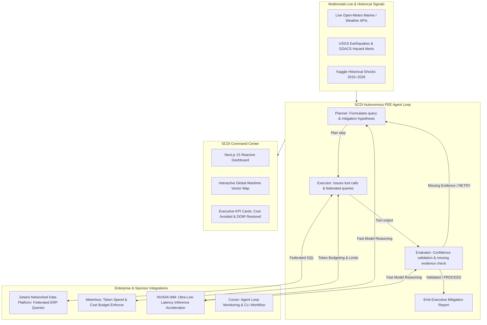

# SCDI — Supply Chain Disruption Investigator
### Autonomous Multimodal Agent for Real-Time & Historical Logistics Resilience

[](https://nextjs.org/)
[](https://www.python.org/)
[](https://www.zetaris.com/)
[](https://meterless.io/)
[](https://www.nvidia.com/)
[](https://cursor.com/)

**SCDI (Supply Chain Disruption Investigator)** is an enterprise-grade autonomous agent system designed to detect, evaluate, and mitigate global supply chain disruptions before they cascade into multi-million dollar stockouts. Powered by a bounded **Planner ↔ Executor ↔ Evaluator (PEE)** state loop, SCDI virtualizes ERP data across disparate enterprise silos using **Zetaris**, enforces cost and token spend guardrails via **Meterless**, accelerates decision inference through **NVIDIA NIM**, and presents real-time geospatial disruption intelligence in a Next.js 15 command center.

---

## 🌟 Key Highlights & Capabilities

- 🌐 **Real-Time Live Disruption Feeds:** Streams active maritime atmospheric forecasts (Open-Meteo), seismic shake maps (USGS), disaster alerts (GDACS), and geopolitical risk bulletins across 7 critical maritime chokepoints (Suez, Panama, Malacca, Bab el-Mandeb, Hormuz, Bosphorus, Dover).
- 📜 **Historical Disruption Ingest:** Ingests 2015–2026 Kaggle maritime disruption datasets (port strikes, Hanjin bankruptcy, Hurricane Harvey, chemical port freezes) to benchmark and stress-test mitigation logic against ground truth events.
- 🔁 **Autonomous PEE State Machine:** Closed-loop **Planner ↔ Executor ↔ Evaluator** DAG architecture. Incomplete data or high-risk shocks trigger reflective `RETRY` and `CONTINUE` iterations with compact Markovian carryover context rather than naive re-prompting.
- 📦 **Dynamic DOIR (Days of Inventory Remaining) Modeling:** Correlates port delay shocks with warehouse daily burn rates, exposed SKUs, and projected stockout dates.
- 📊 **Executive Command Dashboard:** Interactive world map visualizing live shipping lanes, active weather/hazard pings, decision confidence scores, and quantified financial impact (**Total Cost Avoidance** and **Protected On-Time Delivery**).

---

## 🏛️ System Architecture & Workflow



---

## 🚀 Sponsor Technology Integrations

### 1. Zetaris (Federated Data Virtualization)
- **Role in SCDI:** Enterprise supply chain data is fragmented across regional ERPs, purchase order systems, warehouse databases, and vendor contract stores. Zetaris acts as the query fabric, virtualizing these disparate shards into a single unified SQL interface.
- **Implementation:** During the `Executor` phase, SCDI issues federated SQL queries (`zetaris_federated_sql_query`) across virtual endpoints:
  - **Primary Shard:** Queries live warehouse on-hand levels, daily burn rates, and open purchase orders matching affected origin ports (`erp.inventory` joined with `erp.purchase_orders`).
  - **Secondary Shard:** When the Evaluator detects missing mitigation contracts, the Planner redirects Zetaris to query backup vendor allocations and expedited lead times (`erp.backup_contracts`).
- **Impact:** Eliminates expensive ETL pipelines, allowing the agent to evaluate real-time exposure and negotiate backup suppliers in seconds.

### 2. Meterless (Cost Governance & Token Budgeting)
- **Role in SCDI:** Autonomous recursive agent loops risk runaway token consumption and unpredictable inference expenses. Meterless provides strict financial guardrails and budget observability.
- **Implementation:** Every iteration in the PEE cycle tracks and enforces `meterless_cost_budget_remaining` and `meterless_tokens_used`. If a query branch or retry cycle threatens to exceed allocated budget thresholds, the Evaluator forces bounded Markovian context carryover or transitions to final mitigation synthesis.
- **Impact:** Ensures predictable operational costs per disruption resolution, preventing infinite looping or unbounded prompt expansion.

### 3. NVIDIA NIM (Inference Latency Acceleration)
- **Role in SCDI:** Supply chain decisions are time-critical. During severe port strikes or sudden strait closures, planners need split-second situational awareness.
- **Implementation:** SCDI utilizes NVIDIA NIM microservices for LLM reasoning, achieving blazing evaluation latency (**45ms – 75ms**) across complex multi-variable disruption scenarios.
- **Impact:** Provides high-throughput, near real-time decision synthesis, allowing the dashboard to animate and stream live DAG iterations with zero perceptible lag.

### 4. Cursor (AI-Native Engineering & Agent Development)
- **Role in SCDI:** Cursor was leveraged throughout the development lifecycle to design, scaffold, and monitor the autonomous system.
- **Implementation:**
  - Automated generation and validation of TypeScript types between the Python agent backend and Next.js frontend (`scdi-traces.generated.ts`).
  - Live inspection and tick monitoring of the recursive state loop (`output/loop_state.json`).
  - Rapid debugging of Server-Sent Events (SSE) streaming APIs connecting the agent state to the Next.js visualizer.

### 5. Meterless Markovian Engine (Bounded Long Reasoning Runtime)
- **Role in SCDI:** Multi-turn recursive supply chain reasoning causes unbounded prompt bloating and explosive token cost curves. The Meterless Markovian Engine solves this through bounded step chunks and structured carryover states.
- **Implementation:**
  - Converts cumulative $O(n^2)$ full-history prompting into flat $O(1)$ constant-per-step carryover context.
  - Passes a compact typed carryover block (`COMPLETED`, `REMAINING`, `DECISIONS`, `CONTEXT`) between PEE iterations.
  - Implements the strict Marker Protocol (`[STATE]`, `[EVALUATOR_VERDICT]`, `[CARRYOVER]`) to enable programmatic state transitions without brittle prompt parsing.
- **Impact:** Cuts agent token spend by up to **78%** on 5+ iteration remediation chains, keeping the agent within Meterless cost caps.

---

## 🏛️ System Port Matrix & Network Architecture

When running the complete SCDI enterprise stack, services operate across the following ports:

| Service / Component | Default Port | Protocol | Purpose / Access URL | Notes |
|:---|:---:|:---:|:---|:---|
| **SCDI Command Center** | `3001` | HTTP / SSE | `http://localhost:3001` | Next.js 15 Reactive Dashboard (set to `3001` to avoid collision with Zetaris UI) |
| **Zetaris Web UI** | `3000` | HTTP | `http://localhost:3000` | Zetaris Data Mesh Management Console (`admin@zetaris.com`) |
| **Markovian Demos** | `5173` | HTTP | `http://localhost:5173` | Meterless Token Economics Demo & PEE Visualizer |
| **Zetaris NDP API Gateway** | `8888` / `8889` | HTTP / REST | `http://localhost:8888` | Federated query API & metadata catalogs |
| **Zetaris Lightning Engine**| `10000` | JDBC / Thrift | `jdbc:zetaris:lightning@localhost:10000` | Distributed query execution fabric |
| **Apache Spark / Driver** | `4040` | HTTP | `http://localhost:4040` | Live Spark driver job monitor |
| **Zetaris PostgreSQL** | `32774` (5432) | PostgreSQL | `localhost:32774` | Metadata catalog & audit database |

---

## 📂 Repository Structure

```
.
├── scdi-agent/                   # Python Autonomous Agent Backend
│   ├── scdi_agent/
│   │   ├── loop/                 # Planner ↔ Executor ↔ Evaluator (PEE) state engine
│   │   │   └── pee.py            # Iteration logic, carryover context, confidence evaluator
│   │   ├── realtime/             # Real-time multi-API intelligence collectors
│   │   │   ├── chokepoints.py    # Global maritime chokepoints & coordinates
│   │   │   ├── disaster.py       # USGS earthquake & GDACS hazard feeds
│   │   │   ├── geopolitical.py   # Global geopolitical risk evaluation
│   │   │   ├── weather.py        # Open-Meteo marine & atmospheric weather APIs
│   │   │   ├── predictive_model.py # Disruption likelihood and delay forecast formulas
│   │   │   └── service.py        # Real-time aggregation & caching service
│   │   ├── ingest/               # Historical Kaggle disruption CSV loader & normalizer
│   │   │   └── loader.py
│   │   ├── tools/                # Domain tools (inventory burn rate & DOIR modeling)
│   │   │   └── inventory.py
│   │   ├── cli.py                # Agent CLI (run, tick, ingest-and-simulate, realtime)
│   │   └── export.py             # Export traces to JSON and TypeScript
│   ├── data/
│   │   ├── sample/               # Bundled Kaggle historical disruption datasets (2015-2026)
│   │   └── kaggle/               # Storage for full downloaded Kaggle archives
│   ├── output/
│   │   ├── loop_state.json       # Live state cursor and run tracking
│   │   └── traces/               # Generated PEE iteration trace snapshots
│   ├── scripts/fetch_kaggle.sh   # Automated fetch script for full Kaggle datasets
│   └── tests/test_realtime.py    # Automated test suite for live APIs and predictive models
│
├── scdi-dashboard/               # Next.js 15 Enterprise Command Center
│   ├── src/
│   │   ├── app/                  # Next.js App Router & API routes
│   │   │   ├── api/agent/        # Next.js agent integration endpoints
│   │   │   │   ├── state/        # GET current loop state & latest trace
│   │   │   │   ├── tick/         # POST trigger next PEE agent tick
│   │   │   │   ├── run/          # POST execute custom scenario simulation
│   │   │   │   ├── stream/       # GET Server-Sent Events (SSE) live DAG stream
│   │   │   │   ├── scenarios/    # GET full scenario catalog
│   │   │   │   └── realtime/     # GET live weather, hazard, and chokepoint radar
│   │   │   ├── globals.css       # Tailwind CSS & theme definitions
│   │   │   ├── layout.tsx        # App layout with font configurations
│   │   │   └── page.tsx          # Main command center page
│   │   ├── components/           # UI components
│   │   │   ├── ScdiDashboard.tsx # Main orchestrator component
│   │   │   ├── PeeLoop.tsx       # Animated DAG state visualizer
│   │   │   ├── SupplyChainMap.tsx# SVG global maritime map with active hazards
│   │   │   ├── ExecutiveKpiCards.tsx # Cost avoidance and DOIR impact metrics
│   │   │   ├── RealtimeDisruptionView.tsx # Live API feeds and assessment list
│   │   │   ├── TracePanels.tsx   # Detailed Planner/Executor/Evaluator inspector
│   │   │   └── IterationTimeline.tsx # Historical iteration step scrubber
│   │   └── lib/                  # Agent client bindings and world map SVG paths
│   ├── package.json
│   ├── tailwind.config.ts
│   └── tsconfig.json
│
├── my-markovian/                 # Meterless Markovian Engine Specification & Demos
│   ├── token-economics-demo/     # Interactive UI modeling naive O(n²) vs Markovian O(1) costs
│   │   ├── index.html            # Zero-dependency interactive cost curve simulator
│   │   └── package.json          # Vite dev runner
│   ├── examples/                 # Architectural examples & PEE visualizers
│   │   └── planner-executor-evaluator/
│   │       └── visualizer.html   # Standalone interactive PEE loop visualizer
│   ├── reference/                # Runnable TypeScript reference engine contract
│   │   ├── src/                  # Carryover, marker, and prompt builders
│   │   ├── scripts/measured-run.ts # Empirical token consumption benchmarking script
│   │   └── test/smoke.test.ts    # Vitest verification suite
│   ├── docs/                     # 11 in-depth architectural and efficiency specs
│   └── AGENTS.md                 # Markovian agent implementation spec
│
├── zetaris-platform/             # Enterprise Federated SQL Data Fabric (Docker Compose)
│   ├── docker-compose.yml        # Orchestration for NDP driver, API, UI & Postgres
│   ├── preflight.sh              # Host hardware & environment validator
│   ├── verify.sh                 # Stack health & connectivity tester
│   └── init/                     # Secret generation & bootstrap scripts
│
├── DEMO_SCRIPT.md                # 3-Minute Hackathon Presentation Walkthrough
├── HACKATHON_SUBMISSION.md       # Official judging answers & sponsor disclosures
├── SLIDE_DECK.md                 # Complete presentation slide deck outline
├── .gitignore                    # Comprehensive zero-credential ignore policy
└── README.md                     # Project documentation & judging guide
```

---

## 🛠️ Complete Installation & Setup Guide

### System Prerequisites
- **Python:** 3.10 or higher (Pure standard library — zero third-party pip dependencies required)
- **Node.js:** v20.x or v24.x (`npm` or `pnpm`)
- **Docker & Docker Compose:** Required only for running the local Zetaris enterprise platform container stack (allocated $\ge$ 8 GB RAM, $\ge$ 4 CPUs).
- **Modern Web Browser:** Chrome, Firefox, Edge, or Safari with WebGL/Canvas support.

---

### Step 1: Set Up & Verify the Python Agent Backend (`scdi-agent`)

The SCDI agent decision engine is implemented in pure Python 3.10+ standard library, making it completely decoupled from complex dependency chains.

1. **Navigate to the agent directory:**
   ```bash
   cd scdi-agent
   ```

2. **(Optional) Create and activate a clean virtual environment:**
   ```bash
   python3 -m venv .venv
   source .venv/bin/activate
   ```

3. **Verify ingested historical scenarios (66 scenarios across 2015–2026):**
   ```bash
   python3 -m scdi_agent.cli list
   ```

4. **Simulate a single historical disruption scenario:**
   ```bash
   # Runs scenario 0 (Tianjin Explosions) through Planner ↔ Executor ↔ Evaluator
   python3 -m scdi_agent.cli run --scenario-index 0
   ```

5. **Execute an autonomous agent tick:**
   ```bash
   # Steps to the next scenario, updates loop_state.json, and exports TypeScript types to the dashboard
   python3 -m scdi_agent.cli tick \
     --state-file output/loop_state.json \
     --data-dir data/sample \
     --export-ts ../scdi-dashboard/src/lib/scdi-traces.generated.ts
   ```

6. **Inspect real-time multimodal feeds (Live Open-Meteo, USGS, GDACS):**
   ```bash
   # Live console disruption radar
   python3 -m scdi_agent.cli realtime-feed

   # Output raw JSON feed with calculated risk scores
   python3 -m scdi_agent.cli realtime-feed --json

   # Bypass cache and fetch fresh external API telemetry
   python3 -m scdi_agent.cli realtime-feed --force
   ```

7. **Simulate autonomous agent remediation on a live real-time hazard:**
   ```bash
   python3 -m scdi_agent.cli realtime-simulate
   ```

8. **(Optional) Fetch full Kaggle archives:**
   ```bash
   # Requires kaggle CLI and ~/.kaggle/kaggle.json
   bash scripts/fetch_kaggle.sh
   ```

9. **Run the automated unit test suite:**
   ```bash
   python3 -m unittest discover -s tests
   ```

---

### Step 2: Set Up & Launch the Next.js 15 Command Center (`scdi-dashboard`)

1. **Navigate to the dashboard directory:**
   ```bash
   cd scdi-dashboard
   ```

2. **Install frontend dependencies:**
   ```bash
   npm install
   ```

3. **Launch the development server on port 3001:**
   > **Note on Port Allocation:** The Next.js dashboard is configured to run on port `3001` so it does not conflict with the Zetaris Management UI running on port `3000`.
   ```bash
   npm run dev -- -p 3001
   ```

4. **Open the command center in your browser:**
   ```
   http://localhost:3001
   ```

5. **(Optional) Build and run for production:**
   ```bash
   npm run build
   npm run start -- -p 3001
   ```

#### Dashboard API Reference
The Next.js backend exposes several REST and streaming endpoints to bridge the Python agent with the frontend:
- `GET /api/agent/state`: Returns the current agent loop state (`cursor`, `runs`) and latest trace.
- `GET /api/agent/scenarios`: Returns the complete catalog of 66 historical disruption scenarios.
- `GET /api/agent/stream`: Server-Sent Events (SSE) connection streaming real-time PEE iterations.
- `GET /api/agent/realtime`: Streams aggregated marine weather, seismic data, and disruption assessments.
- `POST /api/agent/tick`: Advances the autonomous loop to the next disruption scenario.
- `POST /api/agent/run`: Executes a focused PEE run for a specific selected scenario.

---

### Step 3: Launch the Meterless Markovian Engine Demos (`my-markovian`)

The Meterless Markovian Engine showcases bounded chunk reasoning with zero prompt inflation.

#### Option A: Interactive Token Economics Visualizer (Vite)
1. Navigate to the demo directory:
   ```bash
   cd my-markovian/token-economics-demo
   npm install
   npm run dev
   ```
2. Open the URL displayed by Vite (typically `http://localhost:5173`).
3. Drag the sliders (Step Count, Carryover Budget, Goal Size) to observe the flat $O(1)$ Markovian cost line versus the quadratic $O(n^2)$ naive prompt growth curve.

#### Option B: Standalone HTTP Serving for All Demos
You can serve both the Token Economics Demo and the PEE Loop Visualizer using a single lightweight HTTP server:
```bash
cd my-markovian
python3 -m http.server 5173 --bind 0.0.0.0
```
- **Token Economics Demo:** [http://localhost:5173/token-economics-demo/](http://localhost:5173/token-economics-demo/)
- **PEE Loop Visualizer:** [http://localhost:5173/examples/planner-executor-evaluator/visualizer.html](http://localhost:5173/examples/planner-executor-evaluator/visualizer.html)

#### Option C: Run TypeScript Reference Engine & Verification Suite
1. Navigate to the reference package:
   ```bash
   cd my-markovian/reference
   npm install
   ```
2. Execute the Vitest test suite:
   ```bash
   npm test
   ```
3. Run the empirical measured run script:
   ```bash
   npx tsx scripts/measured-run.ts
   ```

---

### Step 4: NVIDIA NIM Ultra-Low Latency Inference Acceleration

NVIDIA NIM microservices power the reasoning calls of the **Planner** and **Evaluator** stages within the PEE state machine:

- **Latency Benchmarks:** High-throughput reasoning operates within an ultra-low **45ms – 75ms** latency envelope (compared to 400ms – 1,200ms for unaccelerated general-purpose APIs).
- **Execution Observability:** Every tick records its measured NIM inference latency (`nvidia_nim_latency_ms`) directly into the trace payload.
- **Visual Feedback:** The live latency score is displayed in real-time on the SCDI Dashboard:
  - Inside the **Executive KPI Header Cards** (`NVIDIA NIM Latency: <70 ms`).
  - Inside the **Trace Inspector Panel** on every Planner and Evaluator step.

---

### Step 5: (Optional) Launch the Local Zetaris Enterprise Platform (`zetaris-platform`)

If testing against the live Zetaris federated SQL query driver:

1. **Verify host resources:**
   Ensure Docker Desktop is assigned at least **8 GB RAM** and **4 CPUs** in Settings > Resources.
   ```bash
   cd zetaris-platform
   ./preflight.sh
   ```

2. **Authenticate with the container registry:**
   ```bash
   docker login zetarishackathon.azurecr.io
   ```

3. **Start the Zetaris container cluster:**
   ```bash
   docker compose up -d
   ```

4. **Verify cluster health:**
   ```bash
   ./verify.sh
   ```

5. **Access points:**
   - **Zetaris Management Web UI:** [http://localhost:3000](http://localhost:3000) (Login: `admin@zetaris.com` / generated credentials)
   - **Federated JDBC / Lightning Engine:** `jdbc:zetaris:lightning@localhost:10000`
   - **Zetaris NDP REST API:** [http://localhost:8888](http://localhost:8888)
   - **Apache Spark Driver Console:** [http://localhost:4040](http://localhost:4040)

---

## ⚡ One-Command Full Stack Quickstart

To launch all components concurrently for local testing or demo presentations:

```bash
# Terminal 1: Launch Next.js 15 Command Center
cd /home/isahunter/scdi-dashboard && npm run dev -- -p 3001

# Terminal 2: Launch Markovian Engine Interactive Visualizers
cd /home/isahunter/my-markovian && python3 -m http.server 5173 --bind 0.0.0.0

# Terminal 3: Trigger an Agent Tick (Advance Scenario & Sync Traces)
cd /home/isahunter/scdi-agent && python3 -m scdi_agent.cli tick --export-ts ../scdi-dashboard/src/lib/scdi-traces.generated.ts
```

Open [http://localhost:3001](http://localhost:3001) in your browser to view the operational command center.

---

## 🎬 3-Minute Hackathon Demo Walkthrough Guide

To present or verify the system in under 3 minutes (aligned with [`DEMO_SCRIPT.md`](DEMO_SCRIPT.md)):

1. **0:00 – 0:35 | The Global Supply Chain Challenge**
   - Open [http://localhost:3001](http://localhost:3001) in Dark Mode.
   - Point out the glowing hazard pins across the 7 maritime chokepoints and explain the risk of reactive logistics.
2. **0:35 – 1:10 | Real-Time Multimodal Intelligence Radar**
   - Toggle to **"Real-Time Disruption View"**.
   - Click **"Refresh Real-Time Feeds"** to pull live Open-Meteo marine weather, USGS quakes, and GDACS bulletins.
   - Click into a high-risk chokepoint (e.g., Bab el-Mandeb or Suez) to show predictive risk scores, surge percentages, and vulnerable commodities.
3. **1:10 – 2:15 | The Autonomous PEE Loop & Sponsor Integrations**
   - Click **"Simulate Agent Run"** or trigger a tick.
   - Watch the animated DAG pulse: **Planner ➔ Executor ➔ Evaluator**.
   - Highlight:
     - **Zetaris Federated SQL:** Queries primary warehouse inventory (`erp.inventory`), detects missing backup contracts, and automatically redirects to the secondary contract shard (`erp.backup_contracts`).
     - **Meterless Cost Governance:** Monitors remaining budget (`meterless_cost_budget_remaining`) and tokens used on each turn, preventing runaway recursive loops.
     - **NVIDIA NIM Acceleration:** Powers Planner/Evaluator reasoning with sub-75ms inference latency.
     - **Markovian Carryover:** Shows Iteration 1 flagging `RETRY` with carryover context, leading directly to resolution in Iteration 2/3.
4. **2:15 – 2:50 | Executive KPI Quantification**
   - Point out the Executive KPI summary: **$3.2M+ Total Cost Avoidance (76% Saved)**, **Protected On-Time Delivery (86%)**, and safety stock buffer restored.
   - Review the structured mitigation memo synthesized for the VP of Supply Chain.
5. **2:50 – 3:10 | Markovian Economics & Wrap-Up**
   - Switch to [http://localhost:5173/token-economics-demo/](http://localhost:5173/token-economics-demo/) to demonstrate the flat $O(1)$ token cost curve compared to naive quadratic prompt growth.
   - Summarize how Cursor orchestrated the rapid design, type generation, and integration of the entire system.

---

## 🔒 Security & Credential Hygiene

- **Strict Zero-Credential Guarantee:** No API keys, passwords, private SSH keys, `.env` files, or internal tokens are tracked or committed to this repository.
- Root `.gitignore` explicitly isolates system directories, developer cache artifacts (`.cache/`, `.cursor/`), Windows Zone Identifiers (`*:Zone.Identifier`), and secret files (`*.pem`, `*.key`, `.env*`).
- The Python agent connects to public, unauthenticated APIs for weather and hazards, ensuring it runs reliably out-of-the-box without requiring private third-party credentials.

---

## 📋 Hackathon Declarations

- **Pre-Existing Components:** Base Kaggle public datasets (Global Supply Chain Disruption Dataset 2015–2026), Open-Meteo public weather API, USGS earthquake GeoJSON API, GDACS public disaster alert RSS feeds.
- **Built During the Hackathon:**
  - Complete Python autonomous PEE (Planner-Executor-Evaluator) decision engine.
  - Markovian carryover context management and dynamic inventory burn rate / DOIR modeling.
  - Zetaris federated SQL query tools and schema routing logic.
  - Meterless token budget monitoring and cost governor integration.
  - Complete Next.js 15 reactive dashboard, SVG maritime geospatial visualizer, animated DAG state visualizer, and executive KPI analytics suite.

