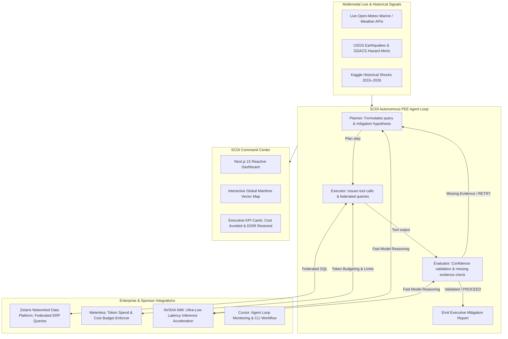

# SCDI — Supply Chain Disruption Investigator
### Autonomous Multimodal Agent for Real-Time & Historical Logistics Resilience

[](https://nextjs.org/)
[](https://www.python.org/)
[](https://www.zetaris.com/)
[](https://meterless.io/)
[](https://www.nvidia.com/)
[](https://cursor.com/)

**SCDI (Supply Chain Disruption Investigator)** is an enterprise-grade autonomous agent system designed to detect, evaluate, and mitigate global supply chain disruptions before they cascade into multi-million dollar stockouts. Powered by a bounded **Planner ↔ Executor ↔ Evaluator (PEE)** state loop, SCDI virtualizes ERP data across disparate enterprise silos using **Zetaris**, enforces cost and token spend guardrails via **Meterless**, accelerates decision inference through **NVIDIA NIM**, and presents real-time geospatial disruption intelligence in a Next.js 15 command center.

---

## 🌟 Key Highlights & Capabilities

- 🌐 **Real-Time Live Disruption Feeds:** Streams active maritime atmospheric forecasts (Open-Meteo), seismic shake maps (USGS), disaster alerts (GDACS), and geopolitical risk bulletins across 7 critical maritime chokepoints (Suez, Panama, Malacca, Bab el-Mandeb, Hormuz, Bosphorus, Dover).
- 📜 **Historical Disruption Ingest:** Ingests 2015–2026 Kaggle maritime disruption datasets (port strikes, Hanjin bankruptcy, Hurricane Harvey, chemical port freezes) to benchmark and stress-test mitigation logic against ground truth events.
- 🔁 **Autonomous PEE State Machine:** Closed-loop **Planner ↔ Executor ↔ Evaluator** DAG architecture. Incomplete data or high-risk shocks trigger reflective `RETRY` and `CONTINUE` iterations with compact Markovian carryover context rather than naive re-prompting.
- 📦 **Dynamic DOIR (Days of Inventory Remaining) Modeling:** Correlates port delay shocks with warehouse daily burn rates, exposed SKUs, and projected stockout dates.
- 📊 **Executive Command Dashboard:** Interactive world map visualizing live shipping lanes, active weather/hazard pings, decision confidence scores, and quantified financial impact (**Total Cost Avoidance** and **Protected On-Time Delivery**).

---

## 🏛️ System Architecture & Workflow



---

## 🚀 Sponsor Technology Integrations

### 1. Zetaris (Federated Data Virtualization)
- **Role in SCDI:** Enterprise supply chain data is fragmented across regional ERPs, purchase order systems, warehouse databases, and vendor contract stores. Zetaris acts as the query fabric, virtualizing these disparate shards into a single unified SQL interface.
- **Implementation:** During the `Executor` phase, SCDI issues federated SQL queries (`zetaris_federated_sql_query`) across virtual endpoints:
  - **Primary Shard:** Queries live warehouse on-hand levels, daily burn rates, and open purchase orders matching affected origin ports (`erp.inventory` joined with `erp.purchase_orders`).
  - **Secondary Shard:** When the Evaluator detects missing mitigation contracts, the Planner redirects Zetaris to query backup vendor allocations and expedited lead times (`erp.backup_contracts`).
- **Impact:** Eliminates expensive ETL pipelines, allowing the agent to evaluate real-time exposure and negotiate backup suppliers in seconds.

### 2. Meterless (Cost Governance & Token Budgeting)
- **Role in SCDI:** Autonomous recursive agent loops risk runaway token consumption and unpredictable inference expenses. Meterless provides strict financial guardrails and budget observability.
- **Implementation:** Every iteration in the PEE cycle tracks and enforces `meterless_cost_budget_remaining` and `meterless_tokens_used`. If a query branch or retry cycle threatens to exceed allocated budget thresholds, the Evaluator forces bounded Markovian context carryover or transitions to final mitigation synthesis.
- **Impact:** Ensures predictable operational costs per disruption resolution, preventing infinite looping or unbounded prompt expansion.

### 3. NVIDIA NIM (Inference Latency Acceleration)
- **Role in SCDI:** Supply chain decisions are time-critical. During severe port strikes or sudden strait closures, planners need split-second situational awareness.
- **Implementation:** SCDI utilizes NVIDIA NIM microservices for LLM reasoning, achieving blazing evaluation latency (**45ms – 75ms**) across complex multi-variable disruption scenarios.
- **Impact:** Provides high-throughput, near real-time decision synthesis, allowing the dashboard to animate and stream live DAG iterations with zero perceptible lag.

### 4. Cursor (AI-Native Engineering & Agent Development)
- **Role in SCDI:** Cursor was leveraged throughout the development lifecycle to design, scaffold, and monitor the autonomous system.
- **Implementation:**
  - Automated generation and validation of TypeScript types between the Python agent backend and Next.js frontend (`scdi-traces.generated.ts`).
  - Live inspection and tick monitoring of the recursive state loop (`output/loop_state.json`).
  - Rapid debugging of Server-Sent Events (SSE) streaming APIs connecting the agent state to the Next.js visualizer.

---

## 📂 Repository Structure

```
.
├── scdi-agent/                   # Python Autonomous Agent Backend
│   ├── scdi_agent/
│   │   ├── loop/                 # Planner ↔ Executor ↔ Evaluator (PEE) state engine
│   │   │   └── pee.py            # Iteration logic, carryover context, confidence evaluator
│   │   ├── realtime/             # Real-time multi-API intelligence collectors
│   │   │   ├── chokepoints.py    # Global maritime chokepoints & coordinates
│   │   │   ├── disaster.py       # USGS earthquake & GDACS hazard feeds
│   │   │   ├── geopolitical.py   # Global geopolitical risk evaluation
│   │   │   ├── weather.py        # Open-Meteo marine & atmospheric weather APIs
│   │   │   └── service.py        # Real-time aggregation & caching service
│   │   ├── ingest/               # Historical Kaggle disruption CSV loader & normalizer
│   │   │   └── loader.py
│   │   ├── tools/                # Domain tools (inventory burn rate & DOIR modeling)
│   │   │   └── inventory.py
│   │   ├── cli.py                # Agent CLI (run, tick, ingest-and-simulate)
│   │   └── export.py             # Export traces to JSON and TypeScript
│   ├── data/sample/              # Bundled Kaggle historical disruption datasets
│   ├── scripts/fetch_kaggle.sh   # Script to pull Kaggle datasets
│   └── tests/test_realtime.py    # Test suite for real-time APIs and disruption services
│
├── scdi-dashboard/               # Next.js 15 Enterprise Command Center
│   ├── src/
│   │   ├── app/                  # Next.js App Router & API routes
│   │   │   ├── api/agent/        # SSE stream, tick, run, and scenario endpoints
│   │   │   ├── globals.css       # Tailwind CSS & theme definitions
│   │   │   ├── layout.tsx        # App layout with font configurations
│   │   │   └── page.tsx          # Main dashboard page
│   │   ├── components/           # UI components
│   │   │   ├── ScdiDashboard.tsx # Main orchestrator component
│   │   │   ├── PeeLoop.tsx       # Animated DAG state visualizer
│   │   │   ├── SupplyChainMap.tsx# SVG global maritime map with active hazards
│   │   │   ├── ExecutiveKpiCards.tsx # Cost avoidance and DOIR impact metrics
│   │   │   ├── RealtimeDisruptionView.tsx # Live API feeds and assessment list
│   │   │   └── TracePanels.tsx   # Detailed Planner/Executor/Evaluator inspector
│   │   └── lib/                  # Agent client bindings and world map SVG paths
│   ├── package.json
│   ├── tailwind.config.ts
│   └── tsconfig.json
│
├── .gitignore                    # Comprehensive zero-credential ignore policy
└── README.md                     # Project documentation & judging guide
```

---

## 🛠️ Setup & Usage Instructions

### Prerequisites
- **Python:** 3.10 or higher
- **Node.js:** v18 or v20+ (`npm` or `pnpm`)
- **Docker:** (Optional, for running local Zetaris platform containers)

---

### Step 1: Set Up & Run the Python Agent Backend

1. Navigate to the agent directory:
   ```bash
   cd scdi-agent
   ```

2. (Optional) Create and activate a Python virtual environment:
   ```bash
   python3 -m venv .venv
   source .venv/bin/activate
   ```

3. Run a sample historical disruption scenario through the PEE loop:
   ```bash
   python3 -m scdi_agent.cli run --data-dir data/sample --scenario-index 0
   ```

4. Run a loop tick (step-by-step state progression):
   ```bash
   python3 -m scdi_agent.cli tick --state-file output/loop_state.json --data-dir data/sample
   ```

5. Ingest historical datasets and export trace outputs for the dashboard:
   ```bash
   python3 -m scdi_agent.cli ingest-and-simulate --data-dir data/sample --limit 7 \
     --export-json output/traces/latest.json \
     --export-ts ../scdi-dashboard/src/lib/scdi-traces.generated.ts
   ```

6. Run the automated test suite:
   ```bash
   python3 -m unittest discover -s tests
   ```

---

### Step 2: Set Up & Run the Next.js Dashboard

1. Navigate to the dashboard directory:
   ```bash
   cd scdi-dashboard
   ```

2. Install dependencies:
   ```bash
   npm install
   ```

3. Start the Next.js development server:
   ```bash
   npm run dev
   ```

4. Open [http://localhost:3000](http://localhost:3000) in your browser.

---

### Step 3: (Optional) Running the Local Zetaris Platform

If testing against a local Zetaris enterprise query driver:
1. Ensure Docker Desktop is allocated at least 8 GB RAM and 4 CPUs.
2. Sign in to the Zetaris container registry and launch:
   ```bash
   cd zetaris-platform
   docker login zetarishackathon.azurecr.io
   ./preflight.sh
   docker compose up -d
   ./verify.sh
   ```
3. The query engine driver will be accessible at `localhost:10000` / `localhost:4040`.

---

## 🔒 Security & Credential Hygiene

- **Strict Zero-Credential Guarantee:** No API keys, passwords, private SSH keys, `.env` files, or internal tokens are tracked or committed to this repository.
- Root `.gitignore` explicitly isolates system directories, developer cache artifacts (`.cache/`, `.cursor/`), Windows Zone Identifiers (`*:Zone.Identifier`), and secret files (`*.pem`, `*.key`, `.env*`).

---

## 📋 Hackathon Declarations

- **Pre-Existing Components:** Base Kaggle public datasets (Global Supply Chain Disruption Dataset 2015–2026), Open-Meteo public weather API, USGS earthquake GeoJSON API, GDACS public disaster alert RSS feeds.
- **Built During the Hackathon:**
  - Complete Python autonomous PEE (Planner-Executor-Evaluator) decision engine.
  - Markovian carryover context management and dynamic inventory burn rate / DOIR modeling.
  - Zetaris federated SQL query tools and schema routing logic.
  - Meterless token budget monitoring and cost governor integration.
  - Complete Next.js 15 reactive dashboard, SVG maritime geospatial visualizer, animated DAG state visualizer, and executive KPI analytics suite.
